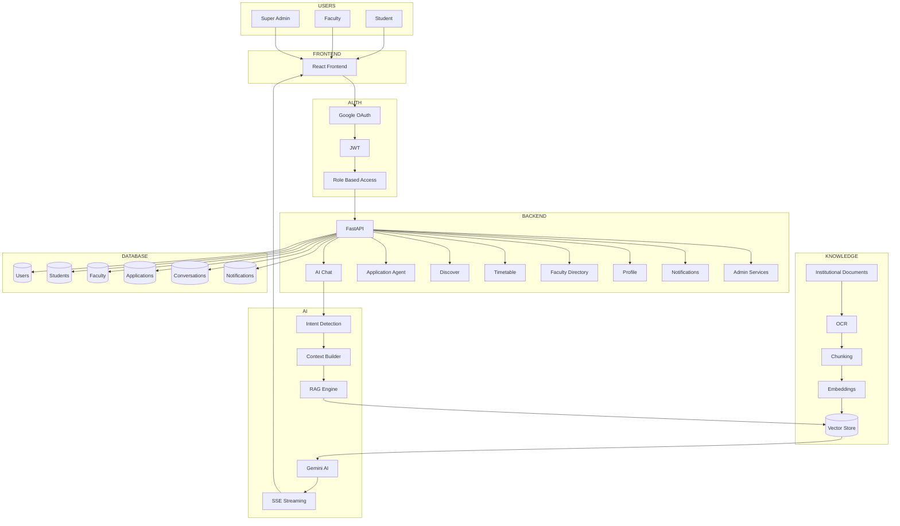
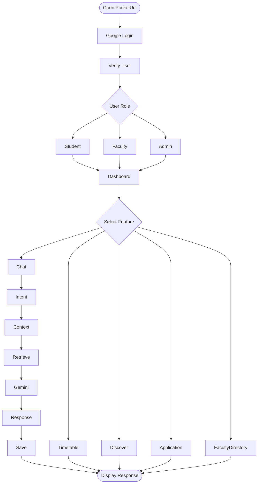
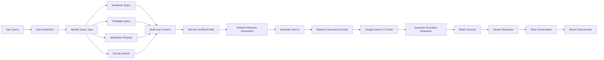

# 🎓 PocketUni

<div align="center">

### AI-Powered Smart Campus Assistant for Madhav Institute of Technology & Science, Gwalior

PocketUni is an intelligent campus platform that combines conversational AI, Retrieval-Augmented Generation (RAG), role-based dashboards, and institutional knowledge into a unified academic assistant for students, faculty, and administrators.

**Your Campus. Our AI.**

<br>


</div>

---

## 🚀 Overview

PocketUni is an AI-powered smart campus assistant designed for **Madhav Institute of Technology & Science (MITS-DU), Gwalior**. The platform enables students, faculty members, and administrators to access institutional information through natural language conversations instead of manually navigating websites, PDFs, notices, or academic portals.

The system combines **Google Gemini**, **Retrieval-Augmented Generation (RAG)**, **OCR**, **Google OAuth**, **real-time communication**, and **role-based dashboards** to deliver accurate, context-aware, and personalized responses using official institutional knowledge.

---

## ✨ Key Highlights

- 🤖 AI-powered conversational campus assistant
- 📚 Retrieval-Augmented Generation (RAG)
- 📄 AI Application Drafting Assistant
- 👥 Discover – Find Teammates
- 📅 Smart Timetable Assistant
- 👨‍🏫 Faculty Directory
- 🔔 Real-time Notifications
- 🔐 Google OAuth Authentication
- 👑 Super Admin Dashboard
- 📑 OCR-powered document processing
- ⚡ Live AI response streaming
- 💬 Persistent conversation history
- 🌐 Institutional knowledge search
- 🎯 Role-based access control
- 📊 Administrative monitoring and management

---

## 🏛 Institution

**Madhav Institute of Technology & Science (Deemed to be University), Gwalior**

**Departments Supported**

- Centre for Artificial Intelligence (CAI)
- Computer Science & Engineering (CSE)
- Internet of Things (IoT)

---

# 📸 Project Preview

| Landing Page | AI Chat |
|--------------|---------|
|  |  |

| Discover | Profile |
|-----------|---------|
|  |  |

| Student Card | Application Agent |
|--------------|-------------------|
|  |  |

| Faculty Directory | Super Admin Dashboard |
|-------------------|-----------------------|
|  |  |

---

# 🎥 Demo

Coming Soon

- 🌐 Live Demo
- 📹 Demo Video
- 📖 Project Documentation

---

# ✨ Features

## 🤖 AI-Powered Academic Assistant

PocketUni enables users to interact with institutional resources using natural language. Powered by **Google Gemini** and **Retrieval-Augmented Generation (RAG)**, it delivers grounded, context-aware responses from official university documents.

### Highlights

- 💬 Conversational AI
- 📚 Institutional RAG
- ⚡ Streaming AI responses
- 📄 Source citations
- 🧠 Context-aware conversations
- 📝 Conversation history

---

## 👨‍🎓 Student Features

- Personalized dashboard
- AI Academic Assistant
- Smart Timetable
- Discover (Find Teammates)
- Faculty Directory
- AI Application Agent
- Notifications
- Profile Management
- Secure Google Login

---

## 👩‍🏫 Faculty Features

- Faculty Dashboard
- Review student applications
- AI assistance
- Department information
- Notifications
- Faculty profile management

---

## 👑 Super Admin Features

- Dashboard & Analytics
- User Management
- Faculty Management
- Student Management
- Document Upload
- Knowledge Base Management
- Website Crawler
- RAG Synchronization
- System Monitoring
- Notifications

---

## 📄 AI Application Agent

Generate institutional applications such as:

- Leave Application
- Bonafide Certificate
- NOC Request
- Event Permission
- General Applications

with AI-assisted drafting and workflow tracking.

---

## 👥 Discover

Find students based on

- Skills
- Branch
- Semester
- Interests
- Academic Profile

Designed to simplify collaboration and project team formation.

---

## 📅 Smart Timetable

Automatically provides timetable information using verified user profiles.

Supports

- Next Class
- Today's Schedule
- Weekly Timetable
- Semester-aware timetable retrieval

---

## 📚 Institutional Knowledge Base

PocketUni indexes official institutional resources including

- Academic Regulations
- Timetables
- Notices
- Faculty Information
- Department Documents
- Circulars
- Academic Resources

through Retrieval-Augmented Generation (RAG).

---

## 🔐 Authentication & Security

- Google OAuth Authentication
- JWT Authorization
- Role-Based Access Control
- Secure Sessions
- Protected APIs
- User-specific conversations
- Data isolation

---

## 🔔 Real-Time Communication

- WebSocket synchronization
- Live notifications
- Streaming AI responses
- Application status updates
- Instant dashboard refresh

# 🏗️ System Architecture



---

# 🔄 Process Flow



---

# 🧠 AI Pipeline & RAG Workflow

PocketUni follows a **Retrieval-Augmented Generation (RAG)** architecture to ensure that AI responses are grounded in official institutional knowledge rather than relying solely on a Large Language Model.

Instead of directly sending every question to Gemini, PocketUni first retrieves the most relevant institutional information, builds contextual prompts, and then generates accurate, citation-aware responses.

---

## AI Processing Pipeline



---

## Knowledge Ingestion Pipeline

Official institutional resources are transformed into a searchable AI knowledge base before they become available for conversations.


---

## AI Components

| Component | Purpose |
|------------|---------|
| Intent Detection | Identifies the user's request type |
| Profile Context | Retrieves verified user information |
| RAG Retrieval | Finds relevant institutional documents |
| Gemini 2.5 Flash | Generates intelligent responses |
| SSE Streaming | Streams AI responses in real time |
| Conversation Memory | Maintains chat history |
| Source Citation | Displays document references |

---

## Supported AI Capabilities

- Academic question answering
- Timetable assistance
- Faculty information retrieval
- Student discovery
- Institutional regulation search
- AI-powered application drafting
- Department-specific guidance
- Personalized responses
- Context-aware conversations
- Citation-aware answers

---

## Why RAG?

Traditional Large Language Models may hallucinate or generate outdated information.

PocketUni eliminates this limitation by retrieving official institutional documents before generating responses.

This ensures:

- Accurate answers
- Institution-specific knowledge
- Reduced hallucinations
- Source-grounded responses
- Context-aware reasoning
- Reliable academic assistance

---

# ⚙️ Technology Stack

| Layer | Technology |
|--------|------------|
| Frontend | React 18 |
| Language | TypeScript |
| Build Tool | Vite |
| Styling | Tailwind CSS |
| Backend | FastAPI |
| Language | Python 3.11 |
| Database | PostgreSQL |
| ORM | SQLAlchemy 2 |
| Database Migration | Alembic |
| Authentication | Google OAuth + JWT |
| AI Model | Google Gemini 2.5 Flash |
| AI Framework | RAG |
| OCR | Tesseract OCR |
| Streaming | Server Sent Events (SSE) |
| Realtime | WebSockets |
| API Style | REST API |
| Package Manager | npm + pip |
| Deployment | Vercel + FastAPI |

---

## Development Tools

- VS Code
- Git
- GitHub
- Postman
- Swagger UI
- pgAdmin
- Google AI Studio

---

# 📂 Project Structure

```text
PocketUni
│
├── backend
│   ├── alembic
│   │   └── Database migrations
│   │
│   ├── app
│   │   ├── api
│   │   │   └── REST APIs & Routes
│   │   │
│   │   ├── auth
│   │   │   └── Authentication & Authorization
│   │   │
│   │   ├── core
│   │   │   └── Configuration, Security & Database
│   │   │
│   │   ├── models
│   │   │   └── SQLAlchemy Models
│   │   │
│   │   ├── schemas
│   │   │   └── Pydantic Schemas
│   │   │
│   │   ├── services
│   │   │   ├── AI Services
│   │   │   ├── RAG Engine
│   │   │   ├── Timetable Service
│   │   │   ├── Faculty Services
│   │   │   ├── Discover Module
│   │   │   ├── Application Agent
│   │   │   ├── Notification Service
│   │   │   └── WebSocket Services
│   │   │
│   │   └── main.py
│   │
│   ├── scripts
│   │   └── Seed & Utility Scripts
│   │
│   └── tests
│
├── src
│   ├── assets
│   ├── components
│   ├── pages
│   ├── hooks
│   ├── services
│   ├── context
│   ├── utils
│   ├── types
│   └── App.tsx
│
├── docs
│
├── data
│
├── storage
│
├── public
│
└── README.md
```

---

# 🧩 Core Modules

PocketUni is organized into multiple independent yet interconnected modules.

| Module | Description |
|---------|-------------|
| 🤖 AI Chat | Conversational AI powered by Google Gemini |
| 📚 RAG Engine | Retrieval-Augmented Generation using institutional documents |
| 📄 Application Agent | AI-assisted application drafting and workflow |
| 📅 Timetable Engine | Personalized timetable assistance |
| 👥 Discover | Find teammates based on skills and interests |
| 👨‍🏫 Faculty Directory | Faculty profiles and department information |
| 🔔 Notifications | Real-time notifications and announcements |
| 👤 Profile Management | User profile and personalization |
| 🔐 Authentication | Google OAuth and JWT authorization |
| 👑 Super Admin | System administration and management |
| 📑 OCR Pipeline | Text extraction from scanned institutional documents |
| 🌐 Website Crawler | Knowledge synchronization from institutional websites |
| 💬 Conversation History | Persistent AI conversations |
| 📊 Analytics | Administrative monitoring and insights |

---

# 🗄️ Database Overview

PocketUni uses **PostgreSQL** as its primary relational database for storing user information, academic data, applications, conversations, and institutional resources.

## Primary Entities

| Entity | Purpose |
|----------|----------|
| Users | Authentication and identity |
| Students | Student information |
| Faculty | Faculty records |
| Profiles | Verified user profiles |
| Applications | AI-generated applications |
| Conversations | Chat sessions |
| Messages | Conversation history |
| Documents | Institutional resources |
| Document Chunks | RAG document chunks |
| Notifications | User notifications |
| Departments | Academic departments |
| Roles | Access control |
| Settings | System configuration |

---

## Database Highlights

- Relational PostgreSQL architecture
- SQLAlchemy ORM
- Alembic database migrations
- Role-based data isolation
- User-specific conversation history
- Secure authentication records
- Optimized document retrieval

---

# 🌐 API Overview

PocketUni exposes a RESTful API built using FastAPI.

## Authentication

- Google OAuth
- JWT Authentication
- Protected Routes

---

## Major API Groups

| Endpoint Group | Description |
|----------------|-------------|
| `/auth` | Authentication APIs |
| `/chat` | AI Chat |
| `/applications` | Application workflow |
| `/faculty` | Faculty directory |
| `/discover` | Student discovery |
| `/profile` | User profile |
| `/notifications` | Notifications |
| `/documents` | Knowledge base |
| `/admin` | Administrative APIs |
| `/ws` | WebSocket communication |

---

## API Documentation

After running the backend, Swagger documentation is available at:

```
http://localhost:8000/docs
```

---

# 🚀 Installation

## Prerequisites

Before setting up PocketUni, ensure the following software is installed:

- Node.js (v18 or later)
- npm
- Python 3.11+
- PostgreSQL 18+
- Git

---

## Backend Setup

```bash
cd backend

python -m venv .venv

# Windows
.venv\Scripts\activate

# macOS/Linux
source .venv/bin/activate

pip install -r requirements.txt
```

---

## Configure Environment Variables

Copy

```
.env.example
```

to

```
.env
```

Configure the following values:

```env
DB_HOST=localhost
DB_PORT=5432
DB_NAME=pocketuni
DB_USER=postgres
DB_PASSWORD=your_password

GEMINI_API_KEY=your_gemini_api_key

SUPER_ADMIN_ALLOWLIST=["admin@example.com"]
```

---

## Database Migration

```bash
alembic -c backend/alembic.ini upgrade head
```

---

## Seed Initial Data

```bash
python backend/scripts/seed.py
```

---

## Start Backend

```bash
python -m uvicorn backend.app.main:app --reload
```

Backend:

```
http://localhost:8000
```

Swagger:

```
http://localhost:8000/docs
```

---

## Frontend Setup

```bash
npm install

npm run dev
```

Frontend:

```
http://localhost:5173
```

---

# 👥 Contributors

| Name | Role |
|-------|------|
| **Mahi Gupta** | Full Stack Development, AI Development, RAG Pipeline, Database Design, UI/UX, Documentation, Research |
| **Utsav Kumawat** | Student Mentor & Technical Guidance |

---

## Faculty Mentor

**Dr. Mausam Chouksey**

Department of Artificial Intelligence

Madhav Institute of Technology & Science (Deemed to be University), Gwalior

---

# 🛣️ Roadmap

## Completed

- AI Chat Assistant
- Google OAuth Authentication
- RAG Knowledge Base
- Timetable Assistant
- Faculty Directory
- Discover Module
- Application Agent
- Real-time Notifications
- OCR Pipeline
- Role-Based Access Control
- Conversation History

---

## Planned

- Mobile Application
- Voice Assistant
- Attendance Integration
- LMS Integration
- Placement Assistant
- Event Recommendation Engine
- Smart Academic Analytics
- Campus Navigation
- AI Study Planner
- Alumni Network

---

# 🌟 Future Scope

PocketUni is designed as a scalable AI platform for educational institutions.

Future enhancements include:

- Multi-campus deployment
- Mobile applications
- AI-powered attendance analytics
- Placement recommendation system
- Smart classroom integration
- ERP integration
- Personalized learning recommendations
- Voice-based AI assistant
- Event management
- Academic performance analytics
- Hostel & transport assistance
- Campus navigation using maps

---

# 📄 License

This project has been developed as an academic project for **Madhav Institute of Technology & Science (Deemed to be University), Gwalior**.

The source code is intended for educational and research purposes. Any reuse or redistribution should appropriately credit the original contributors.

---

<div align="center">

### ⭐ If you like PocketUni, consider giving the repository a star!

Built with ❤️ using React, FastAPI, PostgreSQL, Google Gemini, and Retrieval-Augmented Generation (RAG).

</div>
